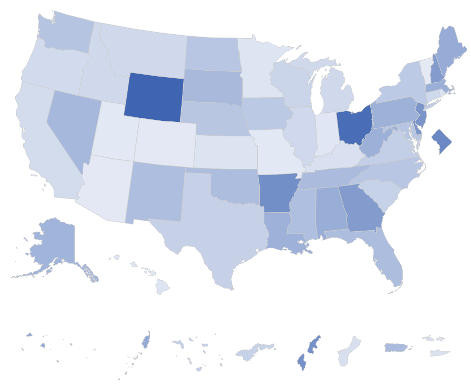

# Get Started

Run the snippets below to see some examples.

```r
highcharter::highchart(type = "map") |> 
  hc_add_custom_map(data = test_data, joinBy = "fips", value = "value", mapType = "c") |>
  highcharter::hc_colorAxis(min = 4600)
```



```r
highcharter::highchart(type = "map") |> 
  hc_add_custom_map(data = test_data, joinBy = "fips", value = "value", mapType = "a") |>
  highcharter::hc_colorAxis(min = 4600)
```

```r
highcharter::highchart(type = "map") |> 
  hc_add_custom_map(data = test_data, joinBy = "fips", value = "value", mapType = "b") |>
  highcharter::hc_colorAxis(min = 4600)
```

```r
data <- test_data
data$categories <- sample(LETTERS[1:3], nrow(data), replace = TRUE)

highcharter::highchart(type = "map") |> 
  hc_add_custom_map_cat(data = data, joinBy = "fips", value = "categories") |>
  highcharter::hc_colorAxis(
    dataClasses = list(
      list(
        from = "A",
        to = "A",
        name = "A"
      ),
      list(
        from = "B",
        to = "B",
        name = "B"
      ),
      list(
        from = "C",
        to = "C",
        name = "C"
      )
    )
  )
```
